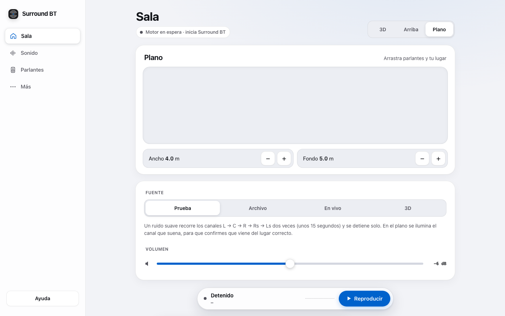
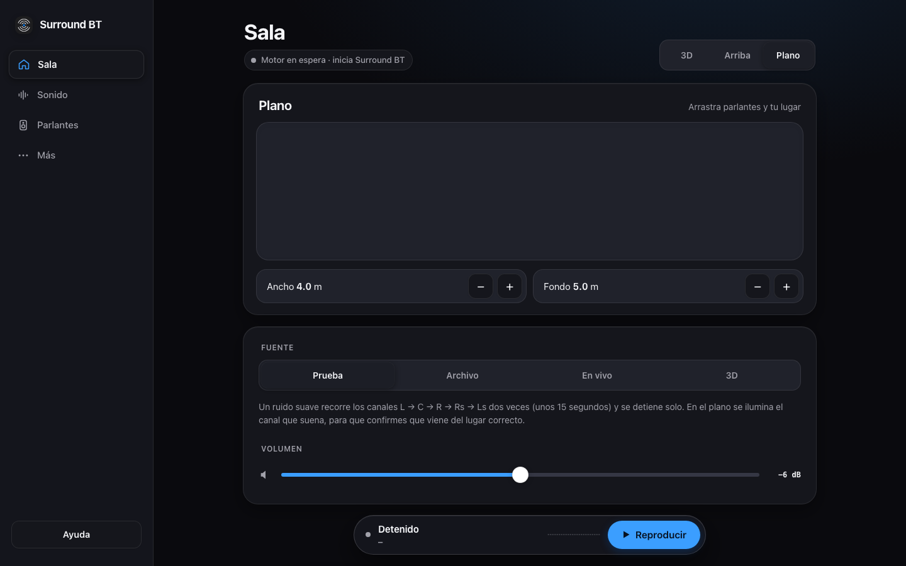

# Surround BT

Sonido envolvente virtual con múltiples parlantes Bluetooth en macOS. Cada parlante recibe su propio canal según su posición en la sala, el micrófono iguala retrasos, volumen y respuesta tonal, y el desfase de reloj Bluetooth se corrige en tiempo real.

| Modo Claro (Escritorio) | Modo Oscuro (Escritorio) |
| :---: | :---: |
|  |  |

---

## Descargar

- **[Descargar Surround BT para Mac (.dmg)](https://github.com/danielmatzenj-png/surround-bt/releases/latest/download/Surround-BT.dmg)**

### Requisitos
- Mac con Apple Silicon (M1 o posterior) y macOS 12 o posterior.
- 2 a 4 parlantes Bluetooth (pueden ser de distintas marcas; la calibración iguala retrasos, volumen y tono).
- Para capturar audio del sistema (Netflix, YouTube, Spotify): [BlackHole 2ch](https://existential.audio/blackhole/) (gratuito).

### Primera apertura (app sin notarizar)
1. Abre el `.dmg` y arrastra **Surround BT** a **Aplicaciones**.
2. Intenta abrirla; si macOS muestra un aviso, ve a **Ajustes del Sistema → Privacidad y seguridad** y selecciona **Abrir igualmente**.
3. Concede permisos de **Micrófono** (para calibración) y **Bluetooth**.

---

## Interfaz y Control

- **Sala 3D y Plano 2D:** ubica parlantes y oyente arrastrándolos; incluye asistente acústico para sugerir ubicaciones según las dimensiones de la sala.
- **Fuentes de audio:** Prueba de canales, Archivo (5.1/7.1 nativo o upmix estéreo con sincronización de video), Audio en vivo del sistema (BlackHole) y Objeto 3D interactivo.
- **Calibración automática:** barridos acústicos con micrófono que igualan retraso (±1 ms), nivel (±0,3 dB) y ecualización FIR de fase lineal en 25 bandas (1/3 de octava).
- **Control remoto desde el móvil:** código QR para controlar la sala desde cualquier navegador en la misma red local Wi-Fi.
- **Modo claro y oscuro:** interfaz adaptable verificada con accesibilidad WCAG 2.2 en móvil, tablet y escritorio.

---

## Ejecutar o Compilar desde el Código

```bash
# Arrancar servidor web local (http://localhost:8890)
python3 -m sbt ui

# Permitir control desde dispositivos en la misma red local
python3 -m sbt ui --lan

# Empaquetar app nativa macOS (.app y .dmg)
./packaging/build.sh
```

### Comandos de terminal
```bash
python3 -m sbt devices            # listar dispositivos de audio disponibles
python3 -m sbt init "Parlante A" "Parlante B"
python3 -m sbt layout             # distribución de canales L/R/C/LFE/Ls/Rs
python3 -m sbt calibrate          # calibración acústica con micrófono
python3 -m sbt test               # recorrido de prueba por canales
python3 -m sbt play video.mkv     # reproducir archivo multicanal o estéreo
python3 -m sbt live               # capturar salida del sistema (BlackHole)
```

---

## Arquitectura Técnica

- **Motor de sincronía (`sbt/engine.py`, `sbt/clock.py`, `sbt/fifo.py`):** salida independiente por parlante con control PI basado en marcas de tiempo de reproducción CoreAudio y remuestreo sinc de 16 puntos con ventana Kaiser.
- **Espacialización y upmix (`sbt/render.py`, `sbt/upmix.py`, `sbt/spatial3d.py`):** VBAP 2D por ángulos reales y separación primario/ambiente en STFT para mantener diálogos centrados.
- **Calibración y ecualización (`sbt/calibrate.py`, `sbt/eq.py`, `sbt/dsp.py`):** cruce de graves Linkwitz-Riley de 4.º orden, EQ de usuario de 8 bandas, EQ automática de 25 bandas, Dynamic EQ, Modo Noche y Voces Claras.
- **Monitoreo acústico (`sbt/monitor.py`):** seguimiento continuo de sincronía (PHAT), volumen adaptativo y enmascaramiento de ruido ambiental.

## Licencia

MIT. Incluye componentes de terceros bajo sus respectivas licencias ([three.js](https://threejs.org), PortAudio, NumPy, SciPy y FFmpeg vía `imageio-ffmpeg`).
